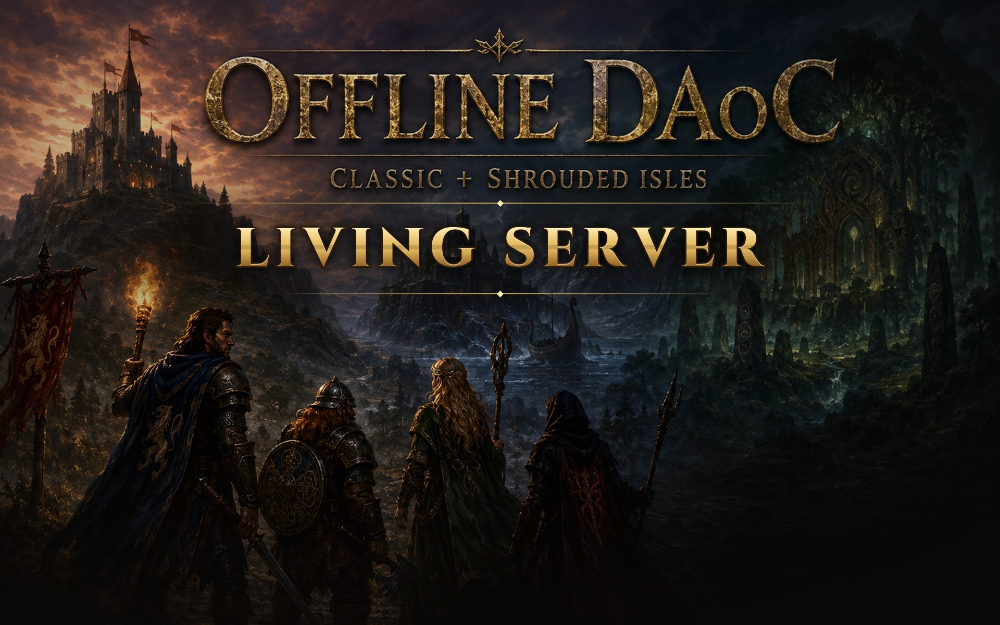

> **Disclaimer.** Dark Age of Camelot is the intellectual property of Electronic Arts and Broadsword
> Online Games. Offline DAoC is not affiliated with, endorsed by, or connected to either company. The
> game client, textures, models and other assets it uses belong to them, and this project is built on
> top of that copyrighted work.
>
> This is a free, non-commercial fan project. It is not a product and it is not for sale. No donations
> are accepted, and the project owner has not made, and will not make, any money from it. The client
> files are the same publicly available ones every free shard uses; the work original to this
> repository is the bot system, the server customizations and the new client's code. Because the code is open source, the
> owner cannot control what forks or other people do with it.
>
> This "time capsule" of the 2002-2003 game was never meant to compete with the current retail Dark Age
> of Camelot, which is a very different, modern experience. If that interests you, please visit the
> official site: [darkageofcamelot.com](https://www.darkageofcamelot.com/).

# Offline DAoC: Living Server

### Your single-player Camelot, alive like a 2003 server. **Beta 1.1 is out.**

It's eight o'clock and the realm is already busy. A guildmate types "wb". A level 12 asks where the
trainer is. Two clerics are arguing smite against rejuv in /faction while an officer calls the keep
under attack, and somewhere a raid is forming for Darkness Falls. None of them are people, and all of
them are playing.

**Living Server** is a free add-on for [shadowofze's Offline DAoC](https://github.com/shadowofze/OfflineDAoC),
the single-player Classic + Shrouded Isles server. Its bots already level, group and fight. Living
Server gives them a life: personalities, guilds, memories, opinions and a voice, and an endgame they
run themselves, whether or not you come along.

> **[Download Beta 1.1](https://github.com/chris4aker/OfflineDAoC-LivingServer/releases/tag/v1.1-beta)**:
> one Setup installs Offline DAoC and Living Server from nothing, or adds Living Server to the 0.36 or 0.37
> game you have (0.37 or 0.37b, with or without the 0.37c new client). Free, every part has its own
> switch, and one click rolls it back. Formerly the **Social Expansion**: if you had it, install over it
> and keep everything. [What's new](https://github.com/chris4aker/OfflineDAoC-LivingServer/releases/tag/v1.1-beta) ·
> [Known issues](docs/KNOWN-ISSUES.md)

## New in Beta 1.1

- **One-click Setup.** No game yet? It downloads Offline DAoC with shadowofze's own downloader. On 0.36? It
  updates you to 0.37 with his official updater and keeps your saves. Then it adds Living Server.
- **The bots talk.** About 34,000 lines and 393 /faction scenes. Reply to a bot's line and it answers; tells
  carry on as conversations.
- **They only say what's true.** Keep, relic and raid news, and "where are the mids?", come from the live
  world.
- **They remember.** Bots remember who they grouped with, you included, and each other.
- **Names like a 2003 server**, built from research into about 700 real names from 2001-2004
  ([the write-up](docs/research/BOT-NAMES-2003.md)).
- **A few things you'll have to find yourself.** Spend some time in your capital, keep /faction open, and
  don't count on every raid going to plan.

## Features

### The endgame runs itself
- **Raids on their own schedule.** Every realm draws its next raid from 17 targets: its dragon, its epic
  dungeon, Summoner's Hall, Darkness Falls and nine raid dungeons from Krondon to Marfach Caverns. It
  rallies, musters at the nearest town and clears its way to the final boss.
- **Wipe, regroup, go again.** A wiped raid rests, rebuffs, walks back in and tries once more, and up to 24
  geared level 50s of the **Epic Special Forces** answer the call.
- **Contested raids.** Two realms in Darkness Falls fight each other on the way. Whoever does the most damage
  to the final boss takes the kill and the loot.
- **Keep sieges with a fight on both sides.** Warbands open sieges, defenders turn out to match the attacking
  army, and attackers break off to save their own keep.
- **Parties go for the boss.** A party grinding a dungeon goes after its named boss when a quest or its loot
  makes the fight worth it.

### Bots that talk like 2003
- **About 34,000 lines of period chat** written for the game from launch to patch 1.65, chosen by realm, class,
  level, zone, time of day, situation and personality, in five writing styles (one of them typo-prone,
  "*fixes" and all). A line doesn't repeat in a realm for three days.
- **393 /faction scenes and debates.** Smite versus rejuv, buffbots, zergs, relic panic, dragon raids. A new cast plays
  one every 30 to 45 minutes while you're online.
- **They read what you type.** "ty", "inc", "rez pls", "lfg 24 cleric" and "is friar good?" are read for what
  they are, and the answers come from the live world: ask "where are the mids?" and you're told where they
  really are.

### Bots with lives
- **Personalities.** Every bot is a Leveler, Socialite, Daredevil, Explorer, Crafter or No-lifer, with five
  traits that decide who grinds, who parks in town, who hunts orange cons and who lives in the frontier.
  Target one and type `/personality`.
- **Bot guilds.** Leveling, social, RvR, raiding and crafting guilds that recruit you, talk in /gu, claim
  and defend keeps, pay dues, earn merit, buy guild buffs and form alliances.
- **Server life.** Bots remember you (your rezzes, and your insults), say grats, announce server firsts,
  ask you for a rez, call incoming zergs, hold grudges against their killers, take "brb" breaks, go
  linkdead, and wave when you walk up. The **Camelot Herald** prints your world's news.

### Smarter, safer bots
- Levelling bots bend their road around monsters far above them, remember where bots keep dying, and bind
  somewhere else when one spot keeps killing them.
- New bots level in their realm's classic zones first, melee bots stop standing under flying monsters,
  parties walk around epic monsters they didn't come for, and warbands ride their porter instead of
  walking past Aidon.
- A bot looking for a group stands at its camp between pulls like a player with /lfg on.

### And more
- **Talk to bots by name:** `/send` any bot of your realm, and `/invite` or `/target` a nearby one.
- **XP by level range:** separate rates for you and the bots, so levels 1 to 34 stay worth playing and 35
  to 50 goes faster.
- **Fixes:** keep gates that never opened in the new client, Lord Gildas's room in Hall of the Corrupt, a
  boss spell chain that could stop the server, and memory leaks found in overnight soak tests.

## Safe to try

- **Your rules stay.** Real loot, the Realm Exchange, stablemaster routes and bots that earn their armor are
  untouched.
- **Every part has its own switch.** Chat, personalities, guilds, server life and XP rates each have a
  switch in the launcher's **Living Server** tab. Setup's first install turns them on at our suggested
  settings unless you untick that option; the manual install leaves them off. The bots' own endgame and
  safer routes are always on.
- **Undo any time.** The installer checks your game version, backs up every file it replaces and verifies
  each copy. `ROLLBACK.cmd` puts the originals back.
- **Tested hard.** 4,093 automated server tests on every build, Windows installer tests with real downloads,
  and two days of play with up to about 1,000 bots online. It's a beta: what hasn't been seen in game yet is
  listed in [docs/KNOWN-ISSUES.md](docs/KNOWN-ISSUES.md).

## How to get it

**The easy way: Setup.**

1. Download `LivingServer-Setup-1.1-beta.exe` from the
   [Beta 1.1 release](https://github.com/chris4aker/OfflineDAoC-LivingServer/releases/tag/v1.1-beta) and run it.
   - No game yet? It downloads Offline DAoC with shadowofze's own downloader.
   - On 0.36? It updates the game to 0.37 with his official updater, keeping your saves.
   - Then it adds Living Server.
2. Windows SmartScreen may say "Windows protected your PC", because the exe isn't code-signed. Click
   **More info**, then **Run anyway**.
3. Open the launcher as usual. It now has a **Living Server** tab.

**By hand:**

1. Install Offline DAoC 0.37 or 0.37b (or 0.37c) from [shadowofze's releases](https://github.com/shadowofze/OfflineDAoC/releases),
   or update your 0.36 game to it (below).
2. Download `OfflineDAoC-LivingServer-1.1-beta.zip` from the
   [Beta 1.1 release](https://github.com/chris4aker/OfflineDAoC-LivingServer/releases/tag/v1.1-beta),
   unzip it and put its folder in your game folder.
3. Close the game and server, then double-click `INSTALL.cmd` in that folder.
4. Open the launcher as usual. It now has a **Living Server** tab.

**Had Beta 1.0 or the Social Expansion?** Either way installs over it. Your characters, bots, bot guilds,
bot memory and settings stay as they were.

**Still on 0.36 with the Social Expansion?** The 0.37 update only applies to the game's own files, so put
them back first: put the Beta 1.1 folder in your game folder and double-click `PREPARE-FOR-UPDATE.cmd` (it
restores the released 0.36 server and launcher from the installer's backups and checks each one). Then
update the game to 0.37 with its downloader (choice 1, Update), and run `INSTALL.cmd`. If you install 0.37
fresh instead and bring your progress over, see the package's README.txt for the one extra step.

## Getting started

A fresh world has no bots yet, and most of these features need some.

1. **Make bots.** On the launcher's main screen, use the **+ Lv.1** and **+ Lv.50** buttons for each
   realm. Raids need level 50s, and a realm needs 8 bots of level 5 or higher before it forms a guild.
2. **Switch features on.** With the server stopped, open the **Living Server** tab, tick what you want
   and click **Save settings**. Good first picks: Bot voices with /faction debates, Bot personalities and
   the Server life parts. Add Bot guilds once you have enough bots.
3. **Start the server and play.** Settings apply at the next server start. A session starts when you log
   in, or come back after half an hour away, and the first /faction scenes come within about its first
   half hour.
4. **Check it's running.** The server log (`runtime\server\logs\server.log`) has a line starting
   `FORK_BUILD name=1.1-beta` that lists which features are on.

## Undo and uninstall

- **Turn a feature off:** untick it in the Living Server tab (or click **ALL OFF**), save, and restart the
  server.
- **Remove bot guilds from your world:** turning bot guilds off keeps the guilds, their alliances and any
  keeps they claimed. To remove them, close the game and server and run
  `python tools\claude-version\set_bot_guilds.py --purge --apply` in your game folder (Python 3). It backs
  up your database first, releases keeps claimed by bot guilds, removes bot guilds and their alliances, and
  moves any of your characters in a bot guild back to the starting guild.
- **Uninstall:** after the steps above, double-click `ROLLBACK.cmd`. It restores the server, launcher and
  game files the install replaced or fixed. If you installed more than one build, run it once per build.
  The new tables and settings stay in your database; the original server ignores them.

## Details

- [Known issues and what's not tested yet](docs/KNOWN-ISSUES.md)
- [Every change, with its numbers](CHANGELOG-LIVING-SERVER.md)
- [Bot guilds: design and status](docs/BOT-GUILDS.md)
- [Bot personalities, voices and debates](docs/BOT-PERSONALITIES.md)
- [Server life and the Camelot Herald](docs/LIVING-SERVER.md)
- [XP by level range](docs/XP-BY-LEVEL-RANGE.md)

## Credits

[shadowofze](https://github.com/shadowofze/OfflineDAoC) made Offline DAoC, and everything here builds on it.
[OpenDAoC](https://github.com/OpenDAoC/OpenDAoC-Core) is the server underneath. Bot-guild membership, route
bends and danger memory are adapted from [stefanrows' fork](https://github.com/stefanrows/OfflineDAoC).
Beta 1.1 also takes fixes from shadowofze's 0.38 work, rambodolphin13's fork and lometur's HearthDAoC, and
the lag fix for large populations came from Krolgosh-web's report (issue #25). Living Server is directed and play-tested by [chris4aker](https://github.com/chris4aker) and coded with
Claude (Anthropic). Same license as the original: GPL-3.0.

---

*Everything below is the original Offline DAoC README.*

# Offline DAoC — single-player Dark Age of Camelot with bots

Offline DAoC is a local, single-player Dark Age of Camelot (Classic + Shrouded Isles, 1.65 rules)
that runs entirely on your own PC. The world is filled with autonomous gamebots that level,
group, trade and fight on their own, and you can recruit companion bots to adventure with you.

It is a community project built on the open-source [OpenDAoC](https://github.com/OpenDAoC/OpenDAoC-Core)
server. Everything it adds to OpenDAoC, and the whole new client, was written by AI tools (Codex, then Claude). The
project owner, who has no game development or coding experience, directed and play-tested it. It is not an official
DAoC product and is not for sale.

## Last release: 0.37

0.37 carries on from 0.36: you can form your own guild and bring gamebots into it, bot armies attack together and
raise their fallen at sieges, groups travel as one pack, raids get further in Caer Sidi and Galladoria, there is far
less lag on a busy server, and the new client gets many fixes. Read [what's new in 0.37](docs/RELEASE-0.37.md), or
every change in the [changelog](CHANGELOG.md).

**0.37 is an update.** If you already play 0.36, 0.36b or 0.36c, you only download the update (much smaller than the
game) and your account, characters, bots and settings stay as they are. If you are new, the same file installs the
complete game for you.

There are three editions. They are the same game on the same server:

| Edition | What it is | Download |
|---|---|---|
| **0.37** (recommended) | The original DAoC client with the classic Classic + SI class list only. There are no Sluaghbinder players or bots. | [v0.37 release](https://github.com/shadowofze/OfflineDAoC/releases/tag/v0.37) |
| **0.37b** | The original DAoC client, with the custom Hibernian class, the **Sluaghbinder** (a pet-summoning undead binder), for players and bots. | [v0.37b release](https://github.com/shadowofze/OfflineDAoC/releases/tag/v0.37b) |
| **0.37c** (BETA) | The game with **two clients**: the original one and a **new client** built in Godot 4. Both play the same account, characters, bots and world, so you can switch whenever you like. It works with 0.37 and with 0.37b. | [v0.37c release](https://github.com/shadowofze/OfflineDAoC/releases/tag/v0.37c) |

**Handy commands:** [QUICK COMMANDS.txt](QUICK%20COMMANDS.txt) lists the in-game commands and launcher shortcuts: teleport to a bot (`/tele`), find monsters of a level (`/mobs`), add 10 or 100 bots at once (Shift or Ctrl + click), and more. Every command is in [ALL SERVER COMMANDS.txt](ALL%20SERVER%20COMMANDS.txt), and both files are in your game folder too.

## Download and play (no Git or AI needed)

1. **Check the requirements:**
   - A 64-bit Windows 10 or 11 PC with a CPU that supports AVX2.
   - 16 GB RAM recommended.
   - Free disk space for a new install: about **20 GB** for 0.37 or 0.37b, about **60 GB** while 0.37c installs.
   - For the original client: the Windows **.NET Framework 3.5** feature. [How to turn it on](docs/PLAY.md#before-you-start).
   - For the new client (0.37c): a graphics card that supports Vulkan or DirectX 12, with current drivers.
2. **Get the downloader:** open the release page of your edition (links above) and download its one zip file:
   `Download-OfflineDAoC-v0.37.zip`, `Download-OfflineDAoC-v0.37b.zip` or `Download-OfflineDAoC-v0.37c.zip`.
   Put it in a folder with a short path, for example `C:\Games\OfflineDAoC`.
3. **Unzip it:** right-click the zip, choose **Extract All…**, and open the extracted folder.
4. **Run it:** double-click `GET-OFFLINE-DAOC-v0.37.cmd` (or `-v0.37b` / `-v0.37c`). If Windows asks, choose
   **Run** (or **More info → Run anyway**). It asks one question:
   - **1 = Update my game** (you have 0.36, 0.36b or 0.36c): close the game, choose your game folder, and only the
     update is downloaded and applied. Everything it replaces is backed up first. If you have the new client, it is
     updated too.
   - **2 = New install** (you don't have the game yet): it downloads the complete game in checked parts into a new
     `playable-v0.37…` folder next to it, then updates it. If it stops, run it again: it continues.
5. **Play:** open your game folder and double-click **START OFFLINE DAOC.cmd** (in 0.37c,
   **START OFFLINE DAOC - NEW CLIENT.cmd** plays with the new client). The launcher shows **VERSION 0.37** (or 0.37b /
   0.37c).
   1. Click **START SERVER** and wait until it says **RUNNING**.
   2. Click **ENTER REALM**.
   3. Your own local account is created automatically the first time.
6. **Create your bots** with the bot buttons in the launcher. Every new install starts with an empty world and
   default settings. [QUICK COMMANDS.txt](QUICK%20COMMANDS.txt) has the shortcuts and in-game commands.

**Want the new client too?** Run `GET-OFFLINE-DAOC-v0.37c.cmd` from the v0.37c release and choose **1 = Update my
game**: if your game doesn't have the new client yet, it offers to add it. Your saves stay as they are, and both
clients play them.

The full walkthrough, with troubleshooting, is in [docs/PLAY.md](docs/PLAY.md). The new client has its own guide:
[docs/NEW-CLIENT.md](docs/NEW-CLIENT.md).

> **Code > Download ZIP** on this page gives you the *source code*, not the playable game. Use the
> downloader from a release page to get the game.

## Already playing an older version?

**0.36, 0.36b or 0.36c:** just update (step 4, choice 1). Nothing else is needed.

**0.35 or older:** install 0.37 (choice 2), then bring your characters, account, items, money, houses **and bots**
over with **IMPORT PROGRESS FROM OLD OFFLINE DAOC.cmd** in the new folder:
1. Close the old and the new game.
2. Run the import tool from the new folder.
3. Pick your old folder.

The tool never changes your old folder, and it backs up the new one first. It works with v0.3,
v0.31, v0.31b, v0.32, v0.32b, v0.33, v0.33b, v0.34, v0.34b, v0.35, v0.35b, v0.36, v0.36b and the "new class test"
builds. In 0.37c, both clients then have your progress. See [docs/TRANSFER-PROGRESS.md](docs/TRANSFER-PROGRESS.md).

## Older versions

Every earlier release is still available and unchanged:
- [v0.36](https://github.com/shadowofze/OfflineDAoC/releases/tag/v0.36),
  [v0.36b](https://github.com/shadowofze/OfflineDAoC/releases/tag/v0.36b) and
  [v0.36c](https://github.com/shadowofze/OfflineDAoC/releases/tag/v0.36c): the full downloads 0.37 updates.
- [v0.35](https://github.com/shadowofze/OfflineDAoC/releases/tag/v0.35) and
  [v0.35b](https://github.com/shadowofze/OfflineDAoC/releases/tag/v0.35b).
- [v0.34](https://github.com/shadowofze/OfflineDAoC/releases/tag/v0.34) and
  [v0.34b](https://github.com/shadowofze/OfflineDAoC/releases/tag/v0.34b).
- [v0.33](https://github.com/shadowofze/OfflineDAoC/releases/tag/v0.33) and
  [v0.33b](https://github.com/shadowofze/OfflineDAoC/releases/tag/v0.33b).
- [v0.32](https://github.com/shadowofze/OfflineDAoC/releases/tag/v0.32) and
  [v0.32b](https://github.com/shadowofze/OfflineDAoC/releases/tag/v0.32b): Darkness Falls beta.
- [v0.31](https://github.com/shadowofze/OfflineDAoC/releases/tag/v0.31) and
  [v0.31b](https://github.com/shadowofze/OfflineDAoC/releases/tag/v0.31b).
- [v0.3](https://github.com/shadowofze/OfflineDAoC/releases/tag/v0.3).

Their download helpers are in [older-versions/](older-versions/), and their notes are in
[docs/history/](docs/history/). Each release's source code stays on its own branch and tag (for
example `release/v0.36` and `v0.36b`), so older code is always there to compare.

## For developers and AI assistants

- **Where to start:** [AGENTS.md](AGENTS.md) (also read by Claude as [CLAUDE.md](CLAUDE.md)) has
  the project rules.
- **Guides:** [docs/DEVELOPMENT.md](docs/DEVELOPMENT.md) covers building and testing, and
  [docs/LLM-QUICKSTART.md](docs/LLM-QUICKSTART.md) covers customizing with your own AI.
- **Where the code is:**
  - `source/server`: the game server and all bot AI.
  - `source/tools`: the launcher, the progress importer and the release tools.
  - `source/new-client`: the new client (Godot 4 project and its content pipeline). See its
    [README](source/new-client/README.md).
  - `tools/pet-art`: the art pipeline used for the custom pets, weapons and spell effects.
- **Forking:** you don't need permission to fork this repository and make it your own. Keep the
  existing licenses and credits ([THIRD_PARTY.md](THIRD_PARTY.md)).

## Good to know

- **What the download includes:**
  - the full game client (0.36c: both clients)
  - clean world data and navigation meshes
  - the launcher and server
  - the progress import tool
  - the bundled .NET runtime
  - the source code

  It does **not** include anyone's account, characters, bots or settings. Every install makes its
  own.
- **Raids are still being tuned.** Bot raids have finished Darkness Falls, Summoner's Hall and
  Tuscaran Glacier, but not yet every epic dungeon to its last boss, and no relic has been captured
  by a bot army yet. See [Known issues](https://github.com/shadowofze/OfflineDAoC/discussions/4).
- **AI-written code can have bugs.** Keep a backup of your save before installing a new build or
  mod. There's no guarantee against regressions.
- **Licensing:** the original game client is a binary dependency. This repository has the server,
  tools, customization source and the new client's source, not the original client's source code.
  The new client's content is converted from the original client's files and ships only in the 0.36c
  download. The server's license doesn't
  relicense third-party client assets or dependencies. See [THIRD_PARTY.md](THIRD_PARTY.md).
- **Local only:** the default setup is for one PC. Running a public multiplayer server would need
  its own security work.

## Videos

## Changes

See the [changelog](CHANGELOG.md).
