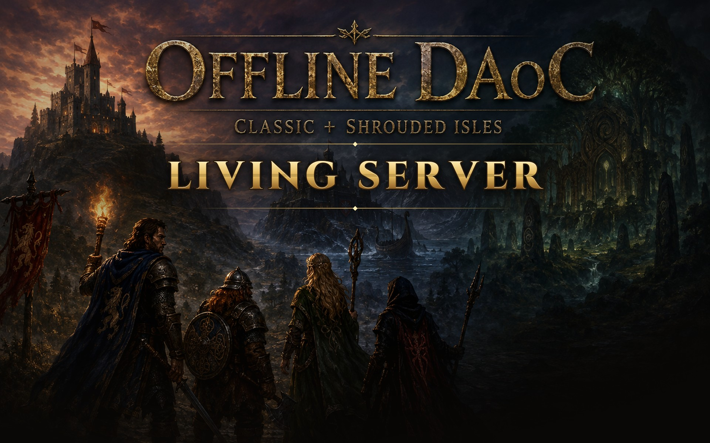

> **Disclaimer.** Dark Age of Camelot is the intellectual property of Electronic Arts and Broadsword
> Online Games. DAoC - Living Server is not affiliated with, endorsed by, or connected to either company. The
> game client, textures, models and other assets it uses belong to them, and this project is built on
> top of that copyrighted work.
>
> This is a free, non-commercial fan project. It is not a product and it is not for sale. No donations
> are accepted, and the project owner has not made, and will not make, any money from it. The client
> files are the same publicly available ones every free shard uses; the work original to this
> repository is the bot system, the server customizations and the new client's code. Because the code is open source, the
> owner cannot control what forks or other people do with it.
>
> This "time capsule" of the 2002-2003 game was never meant to compete with the current retail Dark Age
> of Camelot, which is a very different, modern experience. If that interests you, please visit the
> official site: [darkageofcamelot.com](https://www.darkageofcamelot.com/).

# DAoC - Living Server

### Where Legends Wake and the Realms are Alive. Offline. Never alone.

**1.2.2 is out.**

It's a weeknight in Camelot and the bank is packed. Someone is selling a breastplate they made themselves. A guild
you've never heard of is arguing about Paladin specs. Past the wall, Midgard just took a keep, and a horn is about to
tell your whole realm what happens next. All of it is running on your PC.

**DAoC - Living Server** is a single-player server for Dark Age of Camelot: Classic and Shrouded Isles with 1.65 rules,
on your own PC, with bots who level, group and fight, and who have a life. They talk like 2003 players, keep their own
hours, join guilds, remember you, craft and trade, call their own raids, take each other's keeps, and invite you along.
It is maintained by [chris4aker](https://github.com/chris4aker) and built on earlier open-source work
([credits](CREDITS.md)).

> **[Download Living Server 1.2.2](https://github.com/chris4aker/OfflineDAoC-LivingServer/releases/latest)**: one Setup
> installs the base game files and Living Server from nothing, or adds Living Server to the game you have.
> [What's new in 1.2.2](docs/RELEASE-NOTES-1.2.2.md) · [1.2.1](docs/RELEASE-NOTES-1.2.1.md) · [All of 1.2](docs/RELEASE-NOTES-1.2.md) · [Known issues](docs/KNOWN-ISSUES.md)

Formerly the **Social Expansion** (0.36-se.1 to 0.37-se.2). Install over any earlier build and keep everything.

## What Living Server adds

The tag says which release brought each part. **Base game** marks what the game already did before Living Server, listed only where Living Server
builds on it. **Tests only** means it is in the release but hasn't been seen working on the owner's PC yet.

### A realm full of people

- **Personalities** *(1.0)*. Leveler, Socialite, Daredevil, Explorer, Crafter or No-lifer, with five traits. Target a
  gamebot and type `/personality`.
- **They talk like 2003** *(1.0; rewritten 1.1; tuned since)*. Hand-written period chat in five writing styles, in every
  channel, chosen by realm, class, level, zone, time and what is really happening. About 5 to 7 /faction lines a minute
  on a full realm *(1.2)*.
- **They answer you** *(1.0; first, on their own budget, in 1.2)*. A tell, or a line that names a bot, always gets an
  answer. A bot that says "omw" is coming *(1.2)*.
- **Bot guilds** *(1.0)*: names over their heads, /gu, recruiting, dues, merit, buffs, alliances and keep claims; guild
  crafters who make for guildmates at cost *(1.2)*.
- **They remember you** *(1.0; 1.1.3)*: your rezzes, your insults, your dings.
- **Server life** *(1.0)*: grats, server firsts, rezzes and corpse runs, frontier alarms, nemeses, breaks, body language,
  and an optional real-clock schedule so the capital is busiest in the evening (off by default since 1.2.1: the whole
  roster stays online).
- **Names like a 2003 server** *(1.1)* and **the Herald** *(1.0)*, your world's news page.
- **They dress up** *(1.2)*: dyes and weapon lusters at the merchants' prices. Never glows.
- **Arguments that run for days** in /faction *(1.1; ten more in 1.2)*.

### Bots that play the game, and play with you

- **Levelling like people** *(base game; improved from 1.0)*. Gamebots start without armor and earn it.
- **Talk to bots by name** *(1.0)*: `/send` any online bot of your realm; `/invite` or `/target` a nearby one.
- **Bot leaders invite you** *(1.1.3; 1.2)*. Say yes and the bot leads the camp, the pulls and the breaks. `/lead`,
  `/lead bot`, `/invites off` *(1.2)*. Raid leaders offer level 50s a spot *(1.2)*.
- **Quests with your bot group** *(1.1, 1.1.2)*; epic chains linked on every install *(1.2)*.
- **XP by level range** *(1.0)*.
- **Bots as people** *(1.2; mostly tests only)*: skill that grows, mistakes mostly on strangers, knowing the way, moving
  like people, personal milestones.
- **Built like 2003** *(1.2; tests only)*: new bots come in each realm's 2003 class mix with a period build for life.
  Bots already in your world keep theirs.

### The endgame runs itself

- **Realm raids** *(1.0)*: the dragon, the epic dungeon, Summoner's Hall, Darkness Falls and the raid dungeons, on each
  realm's own schedule. **The tale, then the horn** *(1.2)*: the boss's story in /faction, a call across the screen,
  then the muster. One raid every four hours; no clock inside the dungeon *(1.2)*.
- **The epics at full strength** *(1.2)*: the bosses' own rules back on, each a server setting, and their throws and
  glares pick bots too. Raid sizes from the period and the first tactics *(1.1.2)*; a plan for the real puzzles *(1.2)*.
  **Still being tuned:** the bots lose some of the hardest fights. The notes name them.
- **The frontier** *(1.0; 1.2)*: keep sieges with a defence; enemies who notice you by chance and distance; groups that
  call targets, mez and peel; battleground waves and storms.

### Somebody made that

- **The Realm Exchange and real loot** *(base game, kept)*; bots sell only at natural task breaks.
- **Bot crafters** *(1.2)* at the forges: titles, craft orders, haggling, and sales on the Exchange. **Join an order**
  yourself at a crafting master, as in 1.65 *(1.2; original client; tests only)*.

### Every place has its story

- **Lore** *(1.1; 1.2)*: 108 places, 578 bosses and four realm histories, checked against 832 archived Camelot Herald
  articles. Loremasters in each capital, lore books, the Bestiary in **Realm Records**, `/lore` in either client, bosses
  that speak, and **Atmosphere lines** on screen.

### Company

- **Companions** *(base game; more in 1.2)*: `/spawn` a helper of any class and spec. They stay at the fight when a boss
  throws you *(1.2)*.
- **Hired companions** *(1.2)*: up to seven of your own, hired beside a healer of your realm with `/hire`; you gear and
  train them. Some of the code is borrowed from the True 1.65 project.
- **Play with friends** *(1.2, experimental)*: **HOST FOR FRIENDS**, **JOIN FRIEND** and the **CHARACTER PASSPORT…**.
  Original client only.

### Yours to run

- **The Living Server tab** *(1.0)*: a switch for every part, every part on from the start *(1.2)*. **ALL OFF** gives
  you the plain server.
- **One Setup** *(1.1; 1.1.4)*, **updates from the launcher** *(1.1.2)*, **backups and `ROLLBACK.cmd`** *(1.0; daily
  copies 1.1.2)*.
- **The rules that never change:** real loot, the Realm Exchange, stablemaster routes, selling at natural breaks, bots
  that earn their armor, and Darkness Falls open to solo bots.

## Seen, and tests only

A feature counts as working only once it has been seen working on the owner's PC. 1.2's notes say, feature by feature,
what has been seen and on which build, and what is still tests only. Everything new in 1.2.1 is tests only
([the 1.2.1 notes](docs/RELEASE-NOTES-1.2.1.md)). The parts still tests only include most of Bots as
people, era builds on a fresh world, crafting as a player, a session played with a friend, and every fix made after the
last test build the owner ran. See [the 1.2 notes](docs/RELEASE-NOTES-1.2.md#3-seen-and-tests-only).

## What you need

- A 64-bit Windows 10 or 11 PC with a CPU that supports AVX2.
- 16 GB of memory recommended. More bots need more; start small.
- About 20 GB free for a new install.
- For the original client: the Windows feature **.NET Framework 3.5** ([how](docs/PLAY.md#before-you-start)).

## Install

**With Setup.**
1. Download `LivingServer-Setup-1.2.2.exe` from the [release](https://github.com/chris4aker/OfflineDAoC-LivingServer/releases/latest)
   and run it. No game yet? It downloads the base game files from the project's own copy, several parts at once, and
   checks every file. New installs go to `C:\Games\LivingServer`. Have the game? It adds Living Server where it is.
2. Windows SmartScreen may say "Windows protected your PC", because the exe isn't code-signed. Click **More info**, then
   **Run anyway**.
3. Open **DAoC - Living Server** from the Start menu or the desktop. The launcher has a **Living Server** tab.

From 1.2.3 the files are named for the product: `DAoC-LivingServer-Setup-<version>.exe`, `DAoC-LivingServer-<version>.zip`
and the launcher `DAoCLivingServer.exe`. An existing game keeps its folder and its `OfflineDAoC.exe`, which opens the same
launcher, and keeps updating.

**By hand.** Have the base game ([its files](https://github.com/chris4aker/OfflineDAoC-base-files/releases/tag/v0.37)),
unzip `OfflineDAoC-LivingServer-1.2.2.zip` into your game folder, close the game and server, and run `INSTALL.cmd`.

**On an older base game (0.36)?** Setup brings it up to date, keeping your saves, then adds Living Server (**tests only**: not yet run on the owner's PC). On 0.36 with the Social Expansion, run `PREPARE-FOR-UPDATE.cmd` from this package first.

## Update

- **From 1.1.2 or later:** **Check for updates** in the launcher; START SERVER then reads **GET UPDATE** (Install, Later
  or Skip this version).
- **From anything earlier:** run Setup, or install by hand. Characters, bots, guilds, bot memory and settings stay.
- A world from an earlier build turns on each feature it still had at the old default; your own switches stay.

## Your first evening

1. **Make your realms.** On the launcher's main screen use **+ Lv.1**, **+ Lv.20** and **+ Lv.50** for each realm (Shift
   adds 10, Ctrl adds 100). Raids need level 50s; a realm needs 8 bots of level 5 or higher before it forms a guild.
2. **START SERVER**, then **ENTER REALM**. Your local account is made the first time.
3. Stand in your capital in the evening with /faction open. Type `/lfg`. Ask a bot something.
4. `runtime\server\logs\server.log` has a `FORK_BUILD name=1.2.2` line listing what's on.

## Handy commands

| Command | What it does |
|---|---|
| `/personality` | The personality of the gamebot you have targeted |
| `/send <name>` | Talk to any online bot of your realm |
| `/lfg <message>` | Look for a group; bot leaders may invite you sooner |
| `/lead`, `/lead bot [name]` | Take the lead of a bot-led group, or hand it to a gamebot |
| `/invites on`, `/invites off` | Bot leaders' unasked group and raid invites |
| `/lore`, `/lore <place or boss> [page]` | Your realm's places and bosses, and whether your realm has slain them |
| `/lswhy`, `/lswhy <name>`, `/lswhy me` | Why a bot spoke, or why bots answered your lines, or didn't |
| `/hire`, `/hire list`, `/hire help` | Hire and manage your companions, beside a healer of your realm |
| `/spawn` | A helper of any class and spec |
| `/tele <bot>`, `/tc`, `/stables` | Travel helpers from the base game |

Every command: [QUICK COMMANDS.txt](QUICK%20COMMANDS.txt) and [ALL SERVER COMMANDS.txt](ALL%20SERVER%20COMMANDS.txt).

## Undo and backups

- **Turn a part off:** untick it in the Living Server tab (or **ALL OFF**), save, restart the server.
- **Remove bot guilds:** with the game and server closed, run `python tools\claude-version\set_bot_guilds.py --purge --apply`
  in your game folder. It backs up your database first.
- **Uninstall:** `ROLLBACK.cmd` puts back every file the install replaced. It never puts your world back.
- **Daily backups** go to `runtime\data\backups` (the last 7 are kept), and every install copies your world first.
- **The server listens only on this PC** unless you host for friends; the log warns at each start if it doesn't
  (`NETWORK_EXPOSURE`).

## More

[Known issues](docs/KNOWN-ISSUES.md) · [Every change](CHANGELOG-LIVING-SERVER.md) · [Server life and the Herald](docs/LIVING-SERVER.md) ·
[Bot guilds](docs/BOT-GUILDS.md) · [Personalities and voices](docs/BOT-PERSONALITIES.md) · [Lore](docs/LORE.md) ·
[Crafting](docs/CRAFTING.md) · [Play with friends](docs/PLAY-WITH-FRIENDS.md) · [XP by level range](docs/XP-BY-LEVEL-RANGE.md)

Report a problem on [GitHub](https://github.com/chris4aker/OfflineDAoC-LivingServer/issues) with the `FORK_BUILD` line
from `runtime\server\logs\server.log`.

## Credits

DAoC - Living Server is maintained by [chris4aker](https://github.com/chris4aker). It is built on
[OpenDAoC](https://github.com/OpenDAoC/OpenDAoC-Core) and Dawn of Light, and it started from the original Offline DAoC by
[shadowofze](https://github.com/shadowofze). Every project, fork and person whose work is in it is named in
[CREDITS.md](CREDITS.md), and in the launcher's **About**. GPL-3.0, the same license as the work it is built on.
Third-party notices: [THIRD_PARTY.md](THIRD_PARTY.md).

## Earlier versions

Living Server started as an add-on to Offline DAoC 0.36 and 0.37. Those releases (v0.3 to v0.37c) stay available as
records: their files are in [OfflineDAoC-base-files](https://github.com/chris4aker/OfflineDAoC-base-files/releases), the
original README is kept in [docs/history/OFFLINE-DAOC-README.md](docs/history/OFFLINE-DAOC-README.md), and their notes
are in [docs/history/](docs/history/).

## For developers and AI assistants

- **Where to start:** [AGENTS.md](AGENTS.md) (also read by Claude as [CLAUDE.md](CLAUDE.md)) has
  the project rules.
- **Contributing:** [docs/CONTRIBUTING.md](docs/CONTRIBUTING.md) covers access, claiming an issue, checks and merging.
- **Guides:** [docs/DEVELOPMENT.md](docs/DEVELOPMENT.md) covers building and testing, and
  [docs/LLM-QUICKSTART.md](docs/LLM-QUICKSTART.md) covers customizing with your own AI.
- **Where the code is:**
  - `source/server`: the game server and all bot AI.
  - `source/tools`: the launcher, the progress importer and the release tools.
  - `source/new-client`: the new client (Godot 4 project and its content pipeline). See its
    [README](source/new-client/README.md).
  - `tools/pet-art`: the art pipeline used for the custom pets, weapons and spell effects.
- **Forking:** you don't need permission to fork this repository and make it your own. Keep the
  existing licenses and credits ([THIRD_PARTY.md](THIRD_PARTY.md)).

## Good to know

- **What the download includes:**
  - the full game client
  - clean world data and navigation meshes
  - the launcher and server
  - the progress import tool
  - the bundled .NET runtime
  - the source code

  It does **not** include anyone's account, characters, bots or settings. Every install makes its
  own.
- **Raids are still being tuned.** Bot raids have finished Darkness Falls, Summoner's Hall and
  Tuscaran Glacier, but not yet every epic dungeon to its last boss, and no relic has been captured
  by a bot army yet. See [Known issues](docs/KNOWN-ISSUES.md).
- **AI-written code can have bugs.** Keep a backup of your save before installing a new build or
  mod. There's no guarantee against regressions.
- **Licensing:** the original game client is a binary dependency. This repository has the server,
  tools, customization source and the new client's source, not the original client's source code.
  The server's license doesn't
  relicense third-party client assets or dependencies. See [THIRD_PARTY.md](THIRD_PARTY.md).
- **Local only:** the default setup is for one PC. Running a public multiplayer server would need
  its own security work.

## Videos

## Changes

See the [changelog](CHANGELOG.md).
