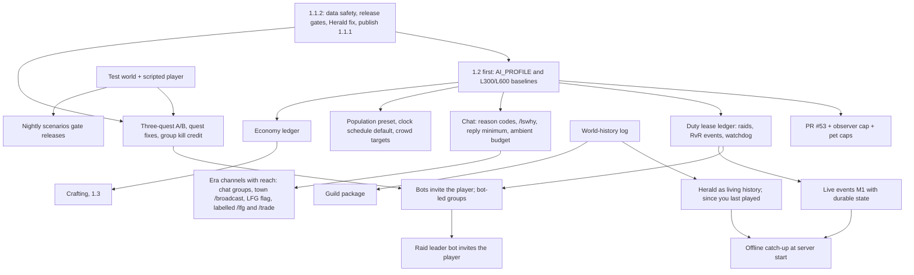

# North Star audit, and the reply to the independent audit (2026-11-03)

Owner 2026-11-03: "audit everything again against our North Star: the most amazing DAoC experience offline with bots
and a world that feels like it's a fully alive peak server from the era, with added features and Easter eggs." The
owner also commissioned an independent audit and asked for a point-by-point answer, with disagreements where the
evidence supports them. This page is both. Three read-only audits stand behind it, in
[audits/2026-11-03/](audits/2026-11-03/):

- [player_experience.md](audits/2026-11-03/player_experience.md): the journey from install to a returning week, scored.
- [plan_and_design.md](audits/2026-11-03/plan_and_design.md): every plan and framework, the contradictions between
  them, the historical evidence, the economy, the persistent society.
- [technical.md](audits/2026-11-03/technical.md): scale, data safety, reliability, delivery, tests, and a simulation of
  PR #53's perception ([perception_sim.py](audits/2026-11-03/perception_sim.py), output in
  [perception_sim_out.md](audits/2026-11-03/perception_sim_out.md)).
- [FORK-SURVEY.md](audits/2026-11-03/FORK-SURVEY.md): shadowofze's main rechecked and every active fork read, with
  what to take and where it fits (added later the same day).

**Labels:** **[V]** verified (code, docs, `gh` or a run), **[I]** inferred, **[E]** estimate, **[O]** owner decision.
Nothing here was played; no server was started; no branch other than this one was changed.

## 1. The verdict

The realm channel feels alive. The street, the group and the calendar don't yet. A 2003 peak server was lived in a
stranger's group invite, in /broadcast at the bind stone, in your guild, and in "you missed it, mids took our relic
Tuesday". Today:
- **You are never wanted.** A bot can't invite the player into a group or a raid [V `AutonomousLivingServer.Tells.cs:14`].
- **The world starts empty and waits for you.** The player builds the population with two launcher buttons (nobody at
  20–49), and nothing happens while the server is off [V].
- **Replies give the bots away.** A blind judge caught 72% of bot lines; 34% of replies ignore what was said [V PR #56].
- **The plan has drifted toward era purity as a gate.** The owner's rule makes era authenticity a tie-breaker; three
  recent decisions (moving bot talk off /lfg and /trade, silence as the general fallback, mostly-silent personas) would
  make a peak server quieter (§4).

The engine is not the main obstacle. It plausibly carries 600 bots per realm today [V docs]. What blocks the North
Star most is that **nothing proves a player journey end to end, nothing measures what each new system costs, and the
save database may not survive a crash** (§3).

## 2. Corrections to the independent audit's facts

| Claim | Finding |
|---|---|
| "1.1.1 released" | Not yet. Main holds Beta 1.1.1 and the package is built, but the GitHub release isn't published [V]. The README saying Beta 1.1 is correct until it is; a version-consistency check in CI prevents the drift when it is published. |
| A flaky SQLite test on PR #56 | Real, but not the database. The test passed; deleting its temp file failed on Windows while a pooled connection was still closing (`UT_AtomicExchangePersistence.cs:161-166`). PR #48's busy-timeout fix is already in PR #56's base [V]. A test-cleanup fix. |
| Main is unprotected | Correct [V: no protection, no rulesets, and CI skips pushes to main]. |
| `ai_budget_ms` is not read | Correct [V: no production caller]. The setting's description promises something the server doesn't do. |
| PR #53: 1−(1−0.03)^N | Correct, and it **understates** the problem: bots re-roll about once a second, so with 10+ bots spread inside 3,500 units, 93–99% engage within 5 s [V simulation of the exact code]. |
| "/lfg and /trade" is a negative claim | Agreed. Our evidence is moderately strong: a 2002 guide's command list, the official 1.62 list of chat send types, and silence through 1.67. It shows there was no *built-in* channel; it does not show realm-wide LFG talk didn't exist (public chat groups existed from 1.60) [V sources, I reading]. |

## 3. The ten challenges

Each row: what exists, what's missing, where we disagree, the smallest step, and its release. Details, file
references, tests and acceptance criteria are in the three audit files (section numbers given).

| # | Challenge | What exists [V] | What's missing | Where we disagree | Smallest step | Release |
|---|---|---|---|---|---|---|
| 1 | **Playable-world proof** | Automated end to end: install, update, rollback, login. Everything else: unit tests plus about 5 h a week of owner play. Quests: never played. | A world fixture without saves, a scripted player, scenarios, a report | Driving the 2003 `game.dll` first is the wrong target: both clients speak one protocol, so a protocol-level scripted player covers most of the risk; one weekly smoke on the real client covers the rest | `make_test_world.py` from the clean release world (no saves by construction), a headless test client reusing the new client's network code, three nightly scenarios: login/save/restart, a kill quest in a bot group, a delivery | 1.2 (technical §8.1) |
| 2 | **RvR perception** | PR #53: chance by distance, reaction delay, spotters alert their group and warband, 8-nearest LOS budget | A cap on how many bots notice one target at once | A full realm-awareness hierarchy is more than 1.2 needs; "false positives" can't occur in this code (a "false contact" would be a new feature) | **Observer cap** (3 rollers per target per second, others learn by the call), calibrate by median time-to-notice per distance, alerted mates engage only if their duty allows; a seeded statistical test | 1.2, on PR #53 (technical §8.2) |
| 3 | **Shared decision architecture** | At least eight sources can claim a bot (raids, RvR events, sieges, Special Forces, frontier engage, the watchdog, groups, `/invite`); the controller arbitrates by statement order | One owner of a bot's time | A four-layer utility rewrite of 9,000+ tuned lines isn't needed: the collisions are about **ownership of a bot's time**, not scoring | A **duty lease ledger**: recruiters claim with a priority and a lease; preempt stores a resume token; the watchdog exempts any leased bot; reason codes logged. Raids and RvR events first | 1.2; live events claim through it from day one (technical §8.3) |
| 4 | **Historical evidence** | Sources cited in prose; class shares and build weights are EU forum samples plus estimates | Provenance per fact; four distributions (population, competitive RvR, levelling, a gimp tail) | Research beyond what a player would notice is over-investment: cap it at "changes a visible behaviour" | `docs/research/era/sources.json` and `facts.json`, fact ids on era-tagged data rows, a CI lint; label `/faction`, Atlas drop rates and the level-50 kit as owner choices | 1.2, small (plan §5) |
| 5 | **Chat benchmark** | One blind round (PR #56), model-written corpus, model judges | State-grounded answers, multi-turn, real veterans, crowd metrics | None: agreed | Tiers T1–T5 (grounded state, 40 sealed multi-turn sessions, a veteran panel with a real-period anchor set, population soak bands, an in-game `/flag`), and a **line-injection test**: adding 200 generic lines must not raise the score | 1.2 (plan §6) |
| 6 | **Runtime budget** | Think intervals, fidelity by distance and population, stall logging of slow turns only | Per-system cost, tick percentiles, any enforcement | Measure before building a scheduler: the profiler is about a day, a scheduler a week aimed possibly at the wrong system | `AI_PROFILE` once a minute (tick p50/p95/p99, serial vs parallel, per system), L300/L600 baselines, then a deferral queue that makes `ai_budget_ms` true (combat never deferred) | Profiler and baselines 1.2 before new systems; enforcement 1.2 if L600 shows planning above 25% of the tick, else 1.3 (technical §8.4) |
| 7 | **Economy** | Faucets, sinks and transfers mapped to code; **no economy logging at all**; guild banks collect dues and never spend coin | A ledger | Agreed on "no tax or sink before the ledger", and stronger: the crafting simulator charges bots repairs, consumables and a tax that don't exist in the code | A `reason` on every coin call site, hourly per-realm counters and wealth percentiles, two weeks of logs, then re-run the simulator | 1.2, instrumentation only (plan §7) |
| 8 | **Durable events** | A history ledger that marks interrupted events on restart | Durable schedule, cooldowns, idempotent world changes; the ledger lives outside `runtime/data` | **Resume is the wrong default** for a single-player server: a resumed half-dead raid feels worse than a clean "Interrupted" | An `offline_event_state` table in the main database; Active → Interrupted on start with tagged spawns undone; persisted seeds, cooldowns and `LastSuccessful` | Small parts 1.2; the state table with live events (technical §8.5) |
| 9 | **Release engineering** | Hash-guarded installs and content patches, rollback, a release train | Protected main, CI on main, version checks, reversible world scripts | A required review would block a one-person project: protect with an **owner bypass** | Fix the test cleanup, protect main (required check, no force-push, owner bypass), CI on push to main, a README/version check, row-level inverses for the world scripts | 1.1.2 (technical §8.6) |
| 10 | **Persistent society** | Memory of the player, nemeses, deeds, bonds, storylines, guilds, server firsts, event records: each with its own keys | A shared history that links them | Agreed; build it on the existing tables, not beside them | An append-only `offline_world_history` with actors; relationship tables gain a link to it; chat, the Herald and the director read it | 1.2 phase D, before the guild package (plan §8) |

**The independent audit's extra ideas:**

| Idea | Verdict | Why |
|---|---|---|
| Herald as living history | **Keep, move into 1.2** | The data exists; dated stories with names ("Tuesday: the Oaken Shield took Caer Benowyc") are the most visible gain per hour of any idea here. Needs an in-game hook too. |
| Persistent social graph | **Keep** | Challenge #10. |
| Offline world progression | **Change** | A bounded catch-up when the server starts after days off: keeps, raid outcomes, bot levels and guild changes, consistent with what the player then sees; told by bots and the Herald; losses allowed; **never gear**; an opt-out. |
| Realm Pulse | **Change** | A small read model (territory, recent outcomes, free 50s, raid readiness) computed from records, not a new simulation. |
| Bot careers | **Change** | Reputation tags read from history and bonds ("reliable healer"), not a progression system. |
| Deterministic replay | **Change** | Seeded rules and scenario capture, yes; full live replay with thread-pool timers and thousands of bots, no. |
| Campaign logistics | **Reject for now** | Supply chores are timer chores; revisit with crafting. |

**Where we disagree overall:** the audit's "1.2 as a foundation release" puts a decision rewrite and a scheduler
before anything visible. We'd measure first (profiler, harness), add the two small foundations that stop real
collisions (the lease ledger, the observer cap), and ship the cheapest felt wins (being invited, quieter weak
replies, a crowded prime time, the Herald's history) in the same release. Its staging would push those to 1.3.

## 4. The purity-versus-fun rules (proposed for the owner)

- **R0.** The owner's gameplay rules (real loot, the Exchange, stablemasters, earned armour, DF open to solo bots)
  outrank everything below.
- **R1.** Alive and busy at prime time > fun > era *form* > era *detail*. Authenticity breaks ties.
- **R2.** The era governs form (channel names, words, mechanics the player sees), not volume. A peak server's noise is
  authentic.
- **R3.** Where the era lacked a convenience, use the era's mechanism first (public chat groups, /broadcast in towns,
  the LFG window). If that can't carry the feel, add an owner feature, labelled, on by default, with a purist switch.
- **R4.** Never remove a working busy-feel feature for purity without a replacement measured to be at least as busy.
- **R5.** Silence is the fallback for replies to the player, never for the ambient world.
- **R6.** Fallible in the world; dependable in the player's group and among bots who know him.
- **R7.** The world goes on without you (outcomes can be lost); your circle centres on you.
- **R8.** Every era rule carries a fact id and a date; an undated claim is a lead, not a rule.
- **R9.** Our own measurements (play sessions, the benchmark tiers, soaks) outrank outside sources.
- **R10.** Easter eggs and added features may break era purity when they're discoverable in fiction and respect R0.

What this changes: the plan to move bot talk off /lfg and /trade becomes "add the era's channels (public chat groups,
town /broadcast, the LFG flag) and keep /lfg and /trade as a labelled convenience, on by default". `/faction`, which
isn't in the 2003 command list either, gets the same label.

## 5. Community feedback, 2026-11-03 (r/daoc)

| Report | Finding [V] | Proposed fix |
|---|---|---|
| Bots invited to a player's guild give no merit or dues | By design (2026-10-16/17): their membership is kept in `offline_world_bot_guild`, "so guild realm points, merit, keep claims and guild buffs never see a bot" (`AutonomousBotGuilds.cs`). Bot guilds' own dues and level-up merit don't apply to them. | **[O]** Count them like players for merit (level-ups *and* realm-rank-ups, or a guild of 50s earns nothing) and dues at the leader's rate. Guild realm points and keep claims stay a separate choice. |
| The Herald shows a guild of 30 bots as one member | A bug: `HeraldPage.cs` counts bots only from the bot guilds' table, not `offline_world_bot_guild`. | Count both. 1.1.2. |
| Mana regeneration is a slog | As built: the base reverted 1.87's doubling (about 12 power per tick at 50), and list casters (a Theurgist) regenerate half as fast below 50% power. **Bots are exempt from that halving; players aren't.** Whether the halving is 1.65-era is unverified. | Launcher options for `mana_regen_amount_modifier` and the below-50% halving, current values as defaults; one rule for bots and players. |
| "Can I join a group run by bots and not lead?" | Not possible: the player always leads. No power-levelling feature exists here or in the base. | **Bot-led groups** (§6, priority 5): a bot leader keeps choosing camps and goals; the player is an ordinary member it heals, buffs and assists; a toggle to lead. Kill credit for quests is fixed first (QUESTING defect 1), or following costs quest progress. |
| A bot-started raid took Bledmeer | The living-world loop working, reported unprompted. | — |

## 6. Revised top ten priorities

| # | Priority | Why | Release |
|---|---|---|---|
| 1 | **Data safety:** check the save database's journal setting on the owner's PC (the default string turns journal and sync off), move to WAL, daily and pre-install backups | One power cut can end a months-long world | 1.1.2 |
| 2 | **Release gates:** test cleanup fix, protected main with owner bypass, CI on main, README/version check, the Herald member-count fix; publish 1.1.1 | Cheap, and everything after depends on trustworthy CI | 1.1.2 |
| 3 | **Quests work with bots:** the three-quest A/B, then PRs #45/#46 and group kill credit | Broken quests read as a broken game, and bot-led groups need kill credit | 1.1.2 → 1.2 |
| 4 | **Measure before adding:** `AI_PROFILE`, L300 and L600 baselines on release/1.2 | Nothing else in 1.2 can be judged without it | 1.2, first |
| 5 | **You are wanted:** bots invite the player; bot-led groups the player can follow; a raid leader bot who invites the player | The defining 2003 loop, and the community's request | 1.2 |
| 6 | **Replies that don't give bots away:** silence below a reply minimum (except direct tells and the bot's name), self-knowledge, context fits, reason codes and `/lswhy`, with a separate ambient budget | The cheapest believability gain the blind round found | 1.2 |
| 7 | **RvR that isn't radar:** PR #53 with the observer cap and calibration, pet caps per group and warband, provisional build weights | The loudest community complaint | 1.2 |
| 8 | **A crowded prime time:** a "2003 server" population preset (a level curve, earned gear), the `clock` schedule on by default, crowd targets at capitals, binds and portal keeps; era channels with reach (§4) | "Peak server" is first a density | 1.2 |
| 9 | **A server with a past:** the Herald as dated stories, "since you last played", server first for a big named kill; bots in player guilds counted (§5); the shared world-history log | Visible, built from data we already keep | 1.2 |
| 10 | **Foundations that stop real failures:** the test world and scripted player; the duty lease ledger with raids and RvR events on it | Proof of journeys; no more bots stolen mid-task | 1.2 |

Next after these: the economy ledger (instrumentation), offline catch-up and durable event state (with live events),
Easter eggs from a sealed file (five), group stances and the discipline trait, then personas, crafting and the rest.

**Defer or cut:** the JSON rule list (G6, cut); storylets as a new engine (extend the existing storylines); 20
personas before the reply fixes are measured; crafting M3–M6 before anyone visibly crafts; more ambient lines (34,000
already exceed what a player reads; add fact-bound lines instead).

## 7. Risks and opportunities

**Three highest risks:**
1. **Data loss.** Journal and sync off by default, no routine or pre-install backup, the event ledger outside
   `runtime/data` [V code; the owner's config unchecked].
2. **Building blind.** No end-to-end proof of player journeys and no per-system cost budget, while six systems that add
   per-bot cost are planned [V].
3. **Competing orders.** Eight sources claim bots, arbitrated by code order; every planned system (events, guild
   duty, crafting) adds another recruiter [V].

**Three highest-value opportunities:**
1. **Being invited:** bots inviting the player, bot-led groups, raid invites. Turns the server from one you run into
   one that wants you.
2. **The world moves on:** a bounded catch-up at server start, told by bots and the Herald.
3. **Prime time:** a populated level curve, the evening schedule on, era channels with reach, crowds where 2003 had
   them.

## 8. Release dependency graph

## 9. The first three tasks

1. **The 1.1.2 safety bundle.** Read the owner's `runtime/server/config/serverconfig.xml` (an owner check); if journal
   is off, ship WAL plus a daily online backup (keep 7) and a backup before `INSTALL.cmd`. Fix the test cleanup race,
   add CI on main and the README/version check, fix the Herald's bot member count. Protecting main is a GitHub setting
   for the owner to approve.
2. **`AI_PROFILE` and the baselines.** Per-system and per-pulse cost, tick percentiles once a minute, and the
   timeline report; then L300 and L600 on release/1.2 with the top-ten table, before any 1.2 system lands.
3. **Bot-led groups, first slice.** Group kill credit for quest steps (QUESTING defect 1), then a bot leader that
   invites the player with a yes/no box (the guild recruit box already works this way), keeps its own camp and goal
   with the player as a member, and a toggle back to leading. Measured by the owner's play: does he get invited within
   an evening at levels 10, 25 and 45.

## 10. Decisions for the owner

1. Bots in a player's guild: merit and dues like a player (proposed yes); guild realm points and keep claims (open).
2. Mana regeneration: launcher options with today's values as defaults, one rule for bots and players (proposed).
3. The purity rules R0–R10 (§4), and with them: /lfg, /trade and /faction kept as labelled conveniences, on by default.
4. Offline catch-up: losses allowed while away, never gear, with an opt-out (proposed). This reverses LIVE-EVENTS-1.2
   rule 2 ("nothing resolves to a loss offline").
5. The level-50 launcher batch's q100 kit and 10,000 gold: a test-world setting, off for a "2003 server" (proposed),
   under the earned-armour rule.
6. Protect main with an owner bypass (a GitHub setting).
7. PR #51 (Setup's fallback copy of the base files) redistributes shadowofze's packages, including the copyrighted
   client: a legal and owner decision before it merges.
8. Cut G6 (the rule list); defer personas and storylets.
9. Easter eggs: a sealed data file, five for 1.2, never in release notes.
10. Insults: soft ignore (open since 2026-11-01).
11. The Sluaghbinder: shadowofze restored it as an edition option on 2026-11-01, after our removal (FORK-SURVEY).
    Follow him, or keep it removed.
12. The 54 EA client files inherited from upstream (FORK-SURVEY): remove them at the tip; whether to purge history.
